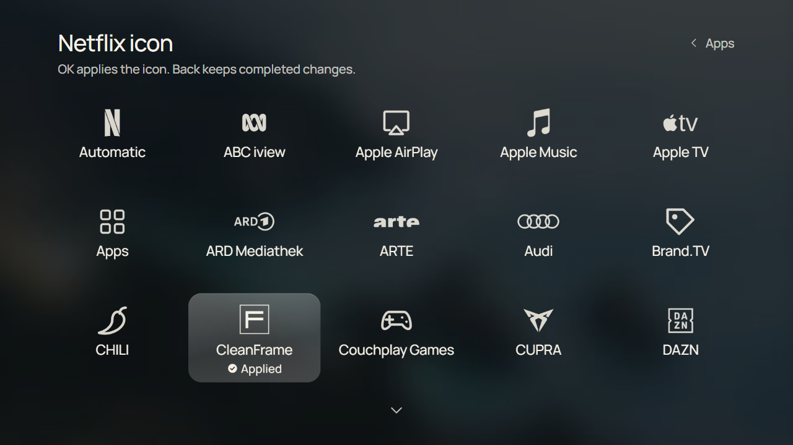

# CleanFrame

This fork adapts CleanFrame for a [Samsung UE49NU8079 running Tizen 4](docs/nu8000.md). Its TV results are in [TV status](docs/tv-status.md). The source app and native Home helper originated on a different Samsung TV.

A quieter home screen for Samsung TVs. Your apps, a photograph and the time, with an interface made for the TV remote.


The original CleanFrame was built for a Samsung The Frame. This fork records a separate adaptation and on-device checks for the UE49NU8079. Other TVs need their own checks.

**Use it at your own risk.** The setup scripts still contain upstream computer, TV and firmware assumptions. Adapt and verify them for your own hardware.

Start with the browser preview, then follow the separate NU8000 build instructions if you have that TV. This fork also has a separate startup service for the tested NU8000. A package-declared Home rule now opens CleanFrame on that TV. An earlier install/rollback test restored Samsung Home, and a new exact baseline is retained for the current assignment. Samsung's native Vconf Home setting was not changed.

## What this fork adds

Compared with [upstream CleanFrame](https://github.com/nthnclrk/CleanFrame), this fork adds:

| Area | Added here |
| --- | --- |
| NU8000 support | A separate Tizen 4 / ARMv7 build overlay, signing configuration and device checks for the UE49NU8079. The ordinary upstream package is not the NU8000 build. [Build and device record](docs/nu8000.md). |
| Automatic launch | A Partner-signed, normal `.NET` service starts CleanFrame after a full TV boot and on the observed standby wake display event. The tested TV does not need a running PC. [Current result and rebuild guide](docs/native-wake.md). |
| Physical Home on the NU8000 | Two separate, Partner-signed app-context packages register CleanFrame and route `XF86Home` to its full application ID. Home currently opens CleanFrame on the tested UE49NU8079, including after a full restart. An earlier test confirmed standby and exact rollback to Samsung Home; the current installation has its own saved rollback baseline. This is separate from upstream's LS03D native Home helper. [Home assignment and recovery](docs/nu8000.md#temporary-physical-home-mapping). |
| Sources | Remote-operated Live TV and HDMI shortcuts with editable names, icons, order and HDMI assignments. [Behaviour and TV checks](docs/sources.md). |
| Backgrounds and widgets | Optional daily online pictures with picture information and credits, a saved small preview during cache restoration, local wallpaper rotation, an optional weather forecast, and a 12/24-hour clock choice. First use stays dark until an image is ready. The owner confirmed a steady image after Home return and a full TV restart on the UE49NU8079. [Pictures](docs/daily-pictures.md) · [Weather](docs/weather.md). |
| Personalisation | Per-app white icon overrides, additional app focus styles, panel opacity and Dock position controls, with previews in Settings. [Interaction guide](docs/interaction-behaviour.md). |
| Reproducibility | Public-font browser preview, regression checks, public export and agent-oriented setup notes. [Development guide](docs/development.md) · [Agent guide](docs/for-agents.md). |

The startup service was confirmed on this fork's UE49NU8079 for a full restart, a short standby cycle and a standby cycle after several minutes of operation. A full boot took more than ten seconds to show CleanFrame in an earlier test. Long-term survival and other firmware versions remain unverified. The physical Home button currently opens CleanFrame through two separate signed packages. The owner confirmed the current assignment after a full restart; the same packages also passed a short standby cycle and exact rollback in an earlier temporary test. The service's certificate, installation and recovery steps are device-specific; it is not an unattended installer for other TVs.



*App icon picker in a 1280 × 720 Chromium preview with synthetic installed apps. This is a browser capture, not a TV photo; see the [screenshot provenance](docs/screenshots/README.md).*

## Try the interface

You need Node.js 22.13+ (22 LTS), or 24+, and Python 3.10+ to run the browser preview.

```sh
git clone https://github.com/Ocramsretep/CleanFrame.git
cd CleanFrame
npm ci
npm run dev:public
```

Open [localhost:4795/home/](http://localhost:4795/home/). Use the arrow keys, Enter and Escape, or click the controls. App launches and Samsung screens require a TV; the preview reports that limitation when you select them.

The public preview uses the included Manrope, Geist and Newsreader fonts.

## What you can change

- Choose a List or Dock layout, with icons, names or both.
- Use a photograph, light or dark background, with a simple 12-hour clock.
- Adjust typography, focus and glass materials through the same Settings interface.
- Choose and reorder Home apps; discover installed apps on the TV.
- Select from fifteen wallpapers and save your preferences locally.

The glass and blur are rendered ahead of time. The TV loads the finished images and uses transforms and opacity for focus feedback.

## Use a coding agent

Open this repo in a local coding agent and give it a bounded change:

```text
Read AGENTS.md, docs/development.md and docs/interaction-behaviour.md.
Help me adapt CleanFrame. Start with the public-font browser preview.
My first change is: <describe one change>.
Preserve remote navigation, saved preferences and the ES5 runtime.
Run the source checks and relevant browser checks. Show the result.
This task is browser-only: do not connect to a TV, sign or install a
package, or change Home/startup settings.
```

See [working with an agent](docs/for-agents.md) for the TV setup prompt and the distinction between UI work, app installation and native Home changes. An agent needs local computer access for TV work; a hosted chat cannot reach your TV merely by reading this repo.

## Put it on a TV

Use the [NU8000 adaptation record](docs/nu8000.md) for this fork's build and device results. The staged [Samsung The Frame setup guide](docs/agent-tv-setup-guide.md) describes the upstream installation process and must be adapted to another TV. It covers Developer Mode, official Samsung tools, certificates, installation, visible checks and recovery.

Signing supports an ignored `.local/signing.json` based on `signing.example.json`: select your SDK, existing certificate profile and your own SDK-generated app identity. See [local signing setup](docs/development.md#local-tv-tools-and-signing). The TV installation commands and native Home helper still contain reference-machine assumptions. Your agent must check the installed-app IDs and each device stage with you. Installing the app and assigning the remote Home button are separate steps.

The [guided NU8000 setup controller](docs/nu8000.md#guided-reference-tv-setup) combines the existing build and installation tools into explicit steps. It signs the Tizen 4 widget, builds the separate startup service and can install missing packages, update the app against an exact prior signed widget, assign Home, verify or restore the exact Home baseline. Device steps require `--apply`; it does not provide an unattended one-command setup or replace the installed startup service. The reference TV has the app, startup service and Home packages installed. Its private device controller and certificates are not part of the public repository.

| Area | Evidence and limits |
| --- | --- |
| This fork's hardware | Samsung UE49NU8079, firmware T-KTM2DEUC-1360.0, Tizen 4.0, ARMv7 |
| App installation | The separate NU8000 build was signed and installed in place; individual visible checks are recorded in the TV status. |
| Startup | The separate native service launches CleanFrame on full boot and observed standby wake. The owner confirmed both; see the [current startup record](docs/native-wake.md). Samsung's “start last app” option is off on the tested TV. |
| Home button | Physical Home currently opens CleanFrame through an `XF86Home` rule plus CleanFrame managed-app registration. A prior rollback restored Samsung Home; the current exact baseline is retained. [TV evidence](docs/tv-status.md#home-result-and-current-state). |
| Still open | The brief Samsung Home flash before CleanFrame, long-term retention and further changed UI and remote flows need checks on this TV. |
| Other TVs | No compatibility claim. This is Tizen source; Android TV, Google TV, LG webOS and Roku need their own implementations. |

The [TV status](docs/tv-status.md) links to the detailed NU8000 record and separates it from the [upstream LS03D results](docs/upstream-tv-status.md). The upstream native Home helper does not target this TV. CleanFrame can also be opened manually without native reassignment.

## Develop and check

```sh
npm run check
npm run check:tools
npx playwright install chromium
CLEANFRAME_PUBLIC_FONTS=1 npm run check:browser
npm run check:public
npm run export:public
```

The browser checks use isolated Chromium profiles and a loopback preview. They never contact a TV. The public export creates `dist/CleanFrame-public-unsigned.wgt`, with public fonts and notices. It needs your own identity and signing before installation. It does not certify asset redistribution rights or device compatibility.

| Location | Purpose |
| --- | --- |
| `app/` | Current packaged UI and runtime assets |
| `scripts/` | Preview, validation, asset generation and reference TV tools |
| [Development](docs/development.md) / [testing](docs/testing.md) | Runtime map, preferences, checks and device boundaries |
| [Assets](docs/assets.md) / [third-party notices](THIRD_PARTY_NOTICES.md) | Rendering recipes, font separation and asset provenance |
| [Asset sources](docs/asset-sources.md) | Photo credits and verification of the bundled third-party assets |
| `.local/`, `dist/` | Ignored private setup, recovery data, generated files and packages |

## Contribute

Fork it, experiment and build something that suits your TV. If you find a useful fix or improve the setup instructions, contributions are welcome. Read [CONTRIBUTING.md](CONTRIBUTING.md) before a larger change. Reports should include model, firmware and the observed result, with private identifiers removed.

## Licence and credits

CleanFrame's original code and documentation use the [MIT licence](LICENSE). Fonts, photographs and logos retain their own terms; read [THIRD_PARTY_NOTICES.md](THIRD_PARTY_NOTICES.md). Paid Pangram binaries are excluded from Git and public exports. A local package may include them, so keep personal builds separate from public downloads.

The [release review](docs/public-release.md) records the publication checks. Third-party assets retain the terms listed in their notices. CleanFrame is an independent project with no Samsung or streaming-service affiliation.

[TV Detox](https://github.com/Ansub/tv-detox) is a useful example of making an agent-assisted TV project approachable. Its Android setup is a different implementation; the prompts and instructions here are written for CleanFrame and Tizen.
