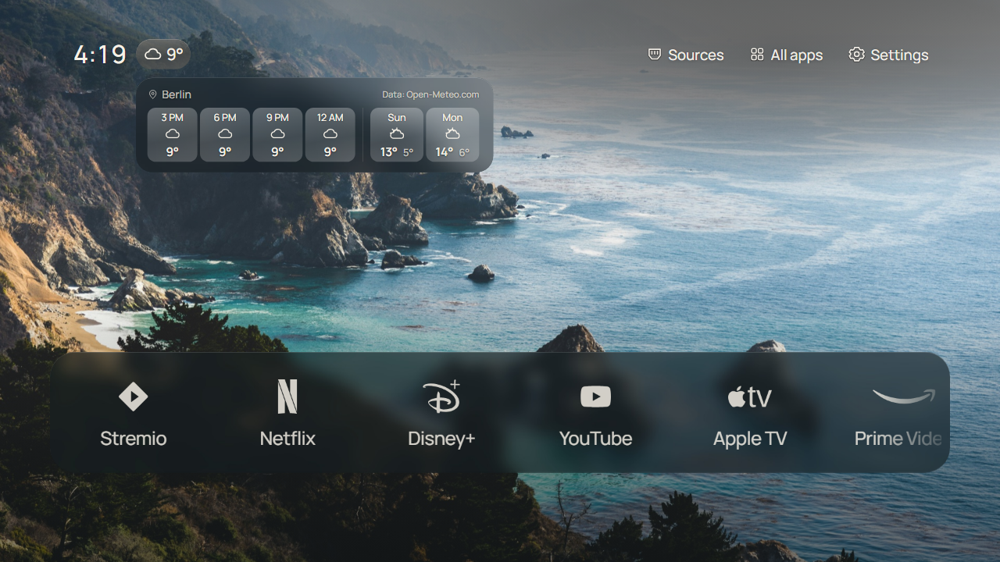

# Weather widget

*The widget beside the clock opens a forecast with four three-hour periods and the following two days. This 1280 × 720 Chromium capture uses the bundled public fonts and synthetic Berlin weather data; it is not a TV capture or a live forecast. See [screenshot provenance](screenshots/README.md).*

Weather is optional and off until the owner chooses a location in Settings → Widgets. No device location permission is requested. Searching sends the typed city or postal code to the [Open-Meteo Geocoding API](https://open-meteo.com/en/docs/geocoding-api). Selecting a result stores its name and coordinates locally, enables weather, and requests the [Open-Meteo Forecast API](https://open-meteo.com/en/docs).

In the location sheet, Left/Right moves between the text field and Search. OK on the field hands Enter to the TV's on-screen keyboard; its Done key or the separate Search button starts the lookup. Back leaves the sheet. The Search button uses the same focused pill treatment as other Settings buttons.

Home shows the current weather code and rounded Celsius temperature beside the clock. OK on the widget opens a compact forecast panel styled like Sources. It groups the next 12 hours into four three-hour periods, showing each period's average temperature and the middle hour's weather code. A separator divides these periods from the following two calendar days, which show weekday abbreviations, weather codes and minimum/maximum temperatures. In Dock, Left from Sources reaches the widget; in List, Up from Sources reaches it. Back closes the panel. The widget appears in the committed Home preview in Settings.

Remote focus highlights the weather chip the same way as an open forecast panel. Background → Panel opacity controls the weather and Sources panel backdrops together with the Dock material; their text and icons remain opaque. The Open-Meteo credit ends at the right edge of the last day tile.

The forecast requests `current=temperature_2m,weather_code,is_day`, `hourly=temperature_2m,weather_code,is_day`, `daily=weather_code,temperature_2m_max,temperature_2m_min`, `forecast_hours=12`, `forecast_days=3`, and `timezone=auto`. Only these returned values are displayed. Built-in SVG outlines represent WMO weather codes; no remote image or runtime blur is needed.

The last valid forecast is cached in localStorage for up to 12 hours. A fresh forecast is requested at most every 30 minutes while weather is enabled and the app is visible; network failures retry after 10 minutes. Failed or malformed responses keep a valid cached forecast. The menu labels saved data and shows an unavailable message when no valid forecast exists. Turning weather off hides the widget and stops requests. Changing the location clears the displayed forecast for the previous place.

Open-Meteo's free API is for non-commercial use under [CC BY 4.0 terms](https://open-meteo.com/en/terms). The forecast panel credits “Data: Open-Meteo.com” at the top right; Settings shows “Weather data by Open-Meteo.com”. The [third-party notices](../THIRD_PARTY_NOTICES.md) retain the source and licence. Location search data is based on GeoNames, as stated in the geocoding documentation.
